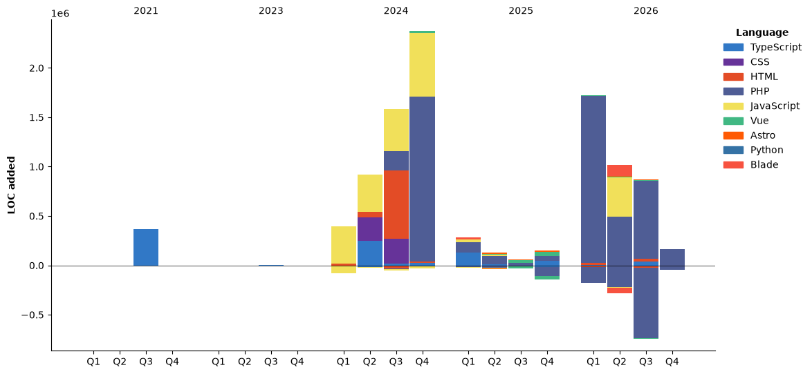

<h1 align="center">
    Hi , I'm Jalil
</h1>
<h3 align="center">
    A passionate Full Stack Web Developer from Azerbaijan
</h3>

[//]: # (- 🌱 I’m currently learning **Golang**)

- 💬 Ask me about anything. I'm happy to help!

- 📫 How to reach me **abdullacelil00@gmail.com**

- 👨‍💻 All of my projects are available at [My Portfolio](https://jalilabdulla.netlify.app)

### Connect with me:

<p align="left">
    <a href="https://linkedin.com/in/jalil-abdullayev" target="_blank">
        
    </a>
    <a href="https://dev.to/jalilabdulla" target="_blank">
        
    </a>
    <a href="https://jalil-abdulla.medium.com/" target="_blank">
        
    </a>
</p>

### Tech Stack:

| Category | Tools |
|---------|-------|
| **Languages** | PHP, JavaScript, TypeScript |
| **Front-end** | Vue, Nuxt, Astro |
| **UI & Utilities** | Tailwind CSS, Alpine.js, HTMX, SCSS, Bootstrap, jQuery |
| **Back-end** | Laravel, NestJS |
| **Full-stack** | Livewire, Filament |
| **Databases** | MySQL, SQLite |
| **Tools** | Git, Postman, Antigravity IDE & CLI, Warp, Netlify |

<p>
    
    
    
</p>

<!--START_SECTION:waka-->


**🐱 My GitHub Data** 

> 📦 922.6 kB Used in GitHub's Storage 
 > 
> 🏆 1,413 Contributions in the Year 2026
 > 
> 💼 Opted to Hire
 > 
> 📜 39 Public Repositories 
 > 
> 🔑 63 Private Repositories 
 > 
**I'm an Early 🐤** 

```text
🌞 Morning                1289 commits        ████████░░░░░░░░░░░░░░░░░   31.91 % 
🌆 Daytime                1767 commits        ███████████░░░░░░░░░░░░░░   43.74 % 
🌃 Evening                923 commits         ██████░░░░░░░░░░░░░░░░░░░   22.85 % 
🌙 Night                  61 commits          ░░░░░░░░░░░░░░░░░░░░░░░░░   01.51 % 
```
📅 **I'm Most Productive on Friday** 

```text
Monday                   491 commits         ███░░░░░░░░░░░░░░░░░░░░░░   12.15 % 
Tuesday                  632 commits         ████░░░░░░░░░░░░░░░░░░░░░   15.64 % 
Wednesday                635 commits         ████░░░░░░░░░░░░░░░░░░░░░   15.72 % 
Thursday                 660 commits         ████░░░░░░░░░░░░░░░░░░░░░   16.34 % 
Friday                   667 commits         ████░░░░░░░░░░░░░░░░░░░░░   16.51 % 
Saturday                 494 commits         ███░░░░░░░░░░░░░░░░░░░░░░   12.23 % 
Sunday                   461 commits         ███░░░░░░░░░░░░░░░░░░░░░░   11.41 % 
```


📊 **This Week I Spent My Time On** 

```text
🕑︎ Time Zone: Asia/Baku

💬 Programming Languages: 
PHP                      13 hrs 7 mins       ████████████████░░░░░░░░░   62.88 % 
Blade Template           5 hrs 46 mins       ███████░░░░░░░░░░░░░░░░░░   27.66 % 
Other                    1 hr 2 mins         █░░░░░░░░░░░░░░░░░░░░░░░░   05.00 % 
JSON                     23 mins             ░░░░░░░░░░░░░░░░░░░░░░░░░   01.89 % 
JavaScript               16 mins             ░░░░░░░░░░░░░░░░░░░░░░░░░   01.33 % 

🔥 Editors: 
VS Code                  18 hrs 10 mins      ██████████████████████░░░   87.09 % 
Codex Vscode             2 hrs 41 mins       ███░░░░░░░░░░░░░░░░░░░░░░   12.91 % 

🐱‍💻 Projects: 
kapital                  10 hrs 39 mins      █████████████░░░░░░░░░░░░   51.08 % 
kapitalist-admin         5 hrs 43 mins       ███████░░░░░░░░░░░░░░░░░░   27.41 % 
livementors              2 hrs 59 mins       ████░░░░░░░░░░░░░░░░░░░░░   14.32 % 
rayonda-admin            54 mins             █░░░░░░░░░░░░░░░░░░░░░░░░   04.35 % 
rayonda                  35 mins             █░░░░░░░░░░░░░░░░░░░░░░░░   02.85 % 

💻 Operating System: 
Windows                  20 hrs 52 mins      █████████████████████████   100.00 % 
```

🤖 **AI Coding This Week** 

```text
⏱ AI Coding Time: 5 hrs 33 mins (26.63%)

✍️ 1,134 lines written by AI, 1,431 lines written by hand (44.21% AI-written)

🔤 1,650,986 Input Tokens, 177,186 Output Tokens

💵 $3.06 Estimated AI Cost This Week

🧠 17 AI Sessions, 93 AI Prompts

GPT                      1,417 lines         █████████████████████████   100.00 % 

🔎 AI Coding Insights:
⚖️ Balanced with AI — 44.21% of written lines came from AI
📚 Verbose Prompter — average 1,901 characters per prompt
🔁 Iterative Prompter — average 5 prompts per session
🔍 Hands-On Reviewer — 60.2% of changed lines were hand-edited
```

**I Mostly Code in PHP** 

```text
PHP                      39 repos            ████████░░░░░░░░░░░░░░░░░   33.33 % 
TypeScript               19 repos            ████░░░░░░░░░░░░░░░░░░░░░   16.24 % 
Astro                    15 repos            ███░░░░░░░░░░░░░░░░░░░░░░   12.82 % 
HTML                     11 repos            ██░░░░░░░░░░░░░░░░░░░░░░░   09.40 % 
C#                       1 repo              ░░░░░░░░░░░░░░░░░░░░░░░░░   00.85 % 
```


**Timeline**




 Last Updated on 31/10/2026 21:49:45 UTC
<!--END_SECTION:waka-->
